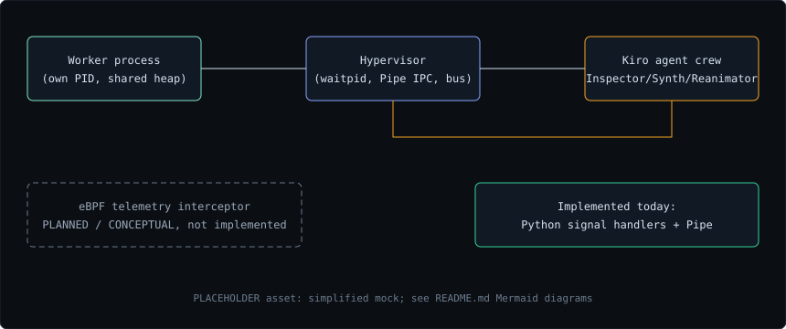
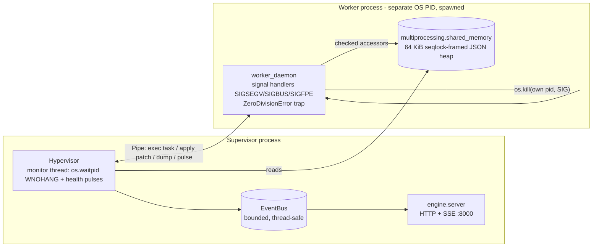
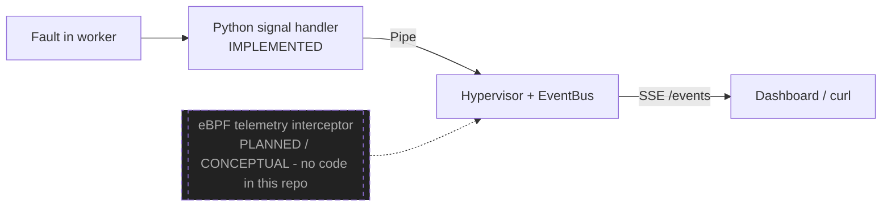
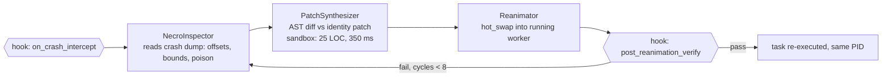
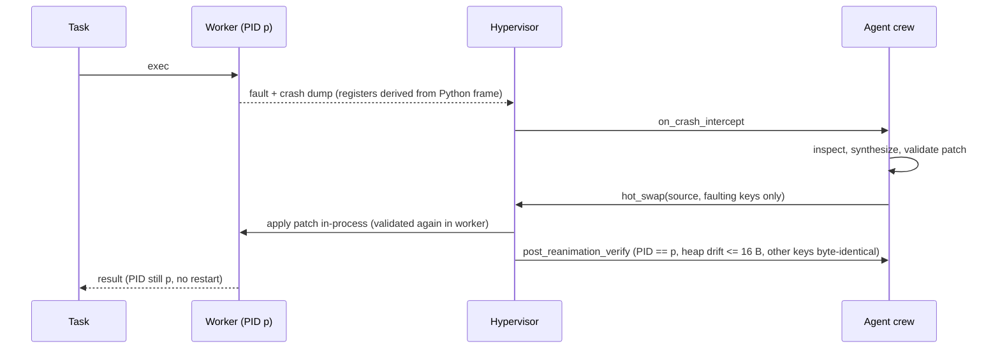

# NecroKernel-OS

[](https://necrokernel-hypervisor.vercel.app)
[](https://youtu.be/gKrssHOq73M)
[]()
[]()

> **Live Interactive Dashboard:** [https://necrokernel-hypervisor.vercel.app](https://necrokernel-hypervisor.vercel.app)  
> **Championship Video Walkthrough:** [https://youtu.be/gKrssHOq73M](https://youtu.be/gKrssHOq73M)

<p align="center">
  
  
  
  
  
  
</p>

Autonomous post-mortem memory inspection and live process reanimation hypervisor
(Kiroween 2026, Frankenstein category). Dead worker parts, living session state, stitched together.

## Real vs simulated

**Real**
- A separate worker OS process (`multiprocessing`) with its own PID, supervised with `os.waitpid`.
- A `shared_memory` heap and `Pipe` IPC between supervisor and worker.
- Python signal handlers; SIGSEGV, SIGBUS and SIGFPE are sent with `os.kill` to the worker's own PID only. ZeroDivisionError is trapped.
- Hot patches are applied inside the running worker, so the PID is identical before and after recovery.

**Simulated**
- The invalid memory access itself. "Corruption" is checked-accessor logic on the shared heap, not a hardware fault.
- Registers and execution pointer in crash dumps are derived from the Python frame.
- A genuine hardware SIGSEGV cannot be resumed in CPython, so it is never produced.
- The MCP gateway is a local simulation with no authentication.

## Architecture



*(The SVG above is a placeholder mock. The Mermaid and ASCII diagrams below are the reference.)*

### 1. Hypervisor IPC



### 2. Telemetry path (eBPF is planned, not implemented)



### 3. Kiro agent crew



### 4. Zero-downtime hotpatching loop



```
 task() --fault--> [capture regs+stack] --> hook --> Inspector --> Synthesizer
    ^                                                                  |
    |                      same PID, no reboot                         v
    +------- re-execute <-- verify heap <-- Reanimator <-- validated patch
```

Deeper detail: [ARCHITECTURE.md](ARCHITECTURE.md). Submission write-up: [DEVPOST_SUBMISSION.md](DEVPOST_SUBMISSION.md).

## Docker

```
docker compose up --build            # engine on http://127.0.0.1:8000 (host loopback only)
docker compose --profile test run --rm tests
```

The Dockerfile and compose file have NOT been built or run (no working container runtime in the authoring sandbox). The engine gains an `NECRO_HOST` env var (default `127.0.0.1`) so the container can bind `0.0.0.0`; compose publishes only on the host loopback because the API has no authentication.

## Layout

| Path | Purpose |
|------|---------|
| `.kiro/specs/` | Reanimation invariants and PBT bounds |
| `.kiro/hooks/` | Crash intercept and post-reanimation verify hooks |
| `.kiro/steering/` | Memory safety invariants; patch limits (max 25 LOC, 350 ms) |
| `.kiro/mcp/` | MCP tool schema |
| `engine/kernel_emulator.py` | Worker, simulated heap, faults, crash dumps |
| `engine/agent_mesh.py` | Tri-agent pipeline and AST sandbox |
| `engine/mcp_gateway.py` | MCP dispatcher |
| `engine/server.py` | Stdlib HTTP daemon on 127.0.0.1:8000 |
| `engine/hypervisor.py`, `engine/worker_daemon.py` | Supervisor, event bus, worker process |
| `dashboard/` | Next.js 14 (App Router) + Tailwind live dashboard |
| `test_reanimation_cycle.py` | End-to-end harness |
| `scripts/measure_recovery.py` | Measures real crash/reanimate cycles against a running server |
| `docs/assets/` | Placeholder SVGs and `measured_recovery.json` (real run output) |

## Patch sandbox

Patches must be a single `def patch(state):`, at most 25 LOC, no imports/while/lambda/try/with,
no dunder access, calls limited to an allowlist, and a 350 ms runtime ceiling. The limits are read
from the steering file at runtime.

## Run

```
pip install -r requirements.txt
python -m pytest -q test_reanimation_cycle.py
```

## Server

```
python -m engine.server        # http://127.0.0.1:8000
curl localhost:8000/health
curl -X POST localhost:8000/workers/session-worker/crash
curl -X POST localhost:8000/rpc -d '{"method":"tools/call","params":{"name":"read_crash_dump","arguments":{"worker":"session-worker"}}}'
```

Endpoints: `GET /health`, `GET /tools`, `GET /workers/<name>`, `POST /rpc` (tools/list, tools/call),
`POST /workers/<name>/crash`, `POST /workers/<name>/reset`. Localhost only, no auth. POSTs must send `Content-Type: application/json`, a localhost `Host`, and either no `Origin` or the allow-listed dashboard origin (otherwise 415/403). A quarantined worker answers 409 and `POST /hv/reset` performs an audited un-quarantine on the same PID (no restart); a dead worker answers 503. `/events` allows at most 16 concurrent streams and rejects non-integer `limit`/`after` with 400.

Security notes: the MCP gateway is a simulation with no authentication. `inject_hotpatch` needs a
prior crash dump, may only change the faulting key, and runs `post_reanimation_verify`. Patches using
`*`, `**`, `<<` or `%` are rejected up front because a single builtin call cannot be interrupted. `range()` accepts only int literals up to 10000, and `+`/`+=` need a statically numeric operand, so `max(range(N))` and `x = x + x` blowups are rejected before execution. Everything else is bounded by the trace-based 350 ms ceiling.
`read_crash_dump` returns a repr of the whole heap snapshot, which is acceptable only in a simulation.
Gateway tools address workers by `worker` name (all simulated workers share one real PID).

SSE and hypervisor endpoints: `GET /events` (event names: state, fault, hook, steering, patch, inspect, mcp, pulse),
`GET /hv/state`, `POST /hv/crash` (`{"kind": null|"nan"|"segv"|"sigbus"|"div0"}`), `POST /hv/reanimate`, `POST /hv/reset`.
CORS allows `http://localhost:3000` and `http://127.0.0.1:3000`.

## Dashboard

```
cd dashboard
npm install
npm run dev        # http://localhost:3000, expects the daemon on 127.0.0.1:8000
```

Set `NEXT_PUBLIC_NECRO_API` to point elsewhere. Panes: Telemetry Terminal (live SSE feed with auto reconnect),
Process Life-Cycle (HEALTHY cyan/green, POISONED/ZOMBIE pulsing red, PATCH SYNTHESIS amber, REANIMATED emerald),
Kiro Audit Trail (hook invocations, steering validations, MCP calls), plus fault, reanimate and reset buttons.

## Verification status

- `python -m pytest -v test_reanimation_cycle.py`: 60 passed, 2 skipped. The skips are the PyYAML spec test and the
  Hypothesis property test (neither package could be installed here). The Hypothesis test is written but has NOT run;
  the invariants were exercised by seeded stdlib random loops instead.
- Dashboard: written but NOT installed, built or run. `npm install` failed here with E403 from the registry, so
  `npm run build` was not run and type correctness is unverified.

PyYAML is optional: the YAML spec test is skipped if it is missing.

## Hackathon narrative

Distributed workers lose sessions when a null dereference or poisoned operand kills them, and the
usual answer is a restart. NecroKernel-OS instead treats the crash as a patient: Kiro hooks catch the
fault, three agents read the dump, synthesize a tiny deterministic sentinel patch under steering
limits, and resume the interrupted task in the same process. The test asserts the PID never changes.
Frankenstein: a monster assembled from specs, hooks, steering, MCP and agents, brought back to life.

## Measured recovery (real run, not a benchmark)

`python scripts/measure_recovery.py 50` against a local server, in a sandbox container: 50 of 50 crash/reanimate cycles
succeeded, worker PID 106 before and after, 0 restarts, 1 cycle each; `/hv/reanimate` HTTP round trip median 3.11 ms,
p95 3.89 ms, max 4.08 ms. Raw output: [`docs/assets/measured_recovery.json`](docs/assets/measured_recovery.json).
Single machine, single run, localhost; not a general performance claim.

## License

[MIT](LICENSE), Copyright (c) 2026 FOKRUL ISLAM. All rights reserved.
